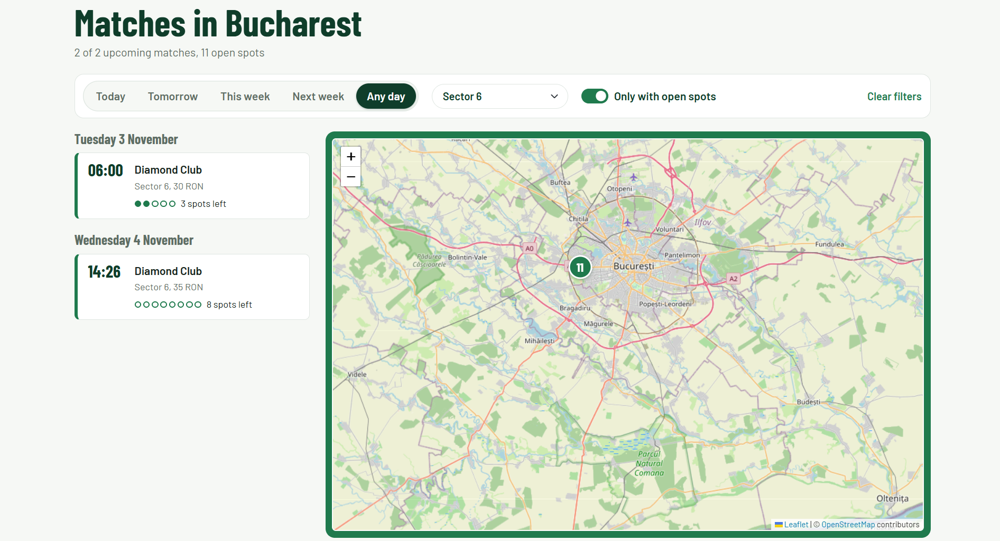
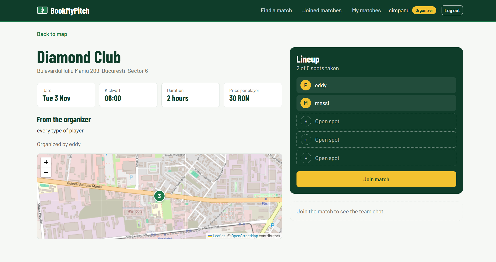
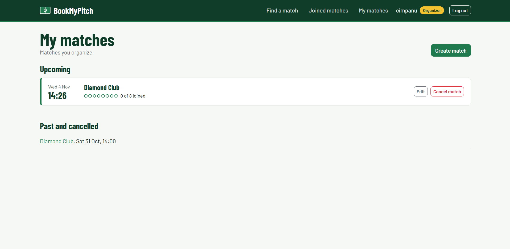

# BookMyPitch

[](https://github.com/eddycimpanu/bookmypitch/actions/workflows/tests.yml)

Find and join pickup football matches on synthetic pitches in Bucharest. Organizers pin pitches on a map and post matches with open spots; players take a spot and coordinate in a team chat.



## Features

- **Interactive map** of upcoming matches, with markers that show open spots and filters by day, sector and availability.
- **Two roles.** Organizers add pitches by clicking on the map, then create, edit and cancel matches and remove players. Players join and leave matches.
- **Safe booking.** The last spot can't be taken twice, even when several players click at the same moment (PostgreSQL row locking with `select_for_update`).
- **Fair-play rules.** A 1-hour cooldown before rejoining a match you left, no rejoining after being removed, and leaving closes 2 hours before kick-off.
- **Private team chat** for the organizer and the players in each match.
- **42 automated tests**, run on every push with GitHub Actions.

## Screenshots

| Match page | Organizer view |
| --- | --- |
|  |  |

## Tech stack

- **Backend:** Python 3.12, Django 6, PostgreSQL
- **Frontend:** Django templates, Bootstrap 5, JavaScript, Leaflet with OpenStreetMap
- **Testing and CI:** Django's test framework, GitHub Actions

## Run locally

```bash
git clone https://github.com/eddycimpanu/bookmypitch.git
cd bookmypitch
python -m venv venv
venv\Scripts\activate          # macOS / Linux: source venv/bin/activate
pip install -r requirements.txt
```

Create a PostgreSQL database, copy `.env.example` to `.env` and fill in your values. Then:

```bash
python manage.py migrate
python manage.py createsuperuser
python manage.py runserver
```

Run the tests with `python manage.py test`.

## Project structure

```
accounts/    custom user model with organizer and player roles, sign up and log in
matches/     pitches, matches, joining rules (services.py), team chat, map API, tests
templates/   Django templates
static/      styles and map / chat scripts
```