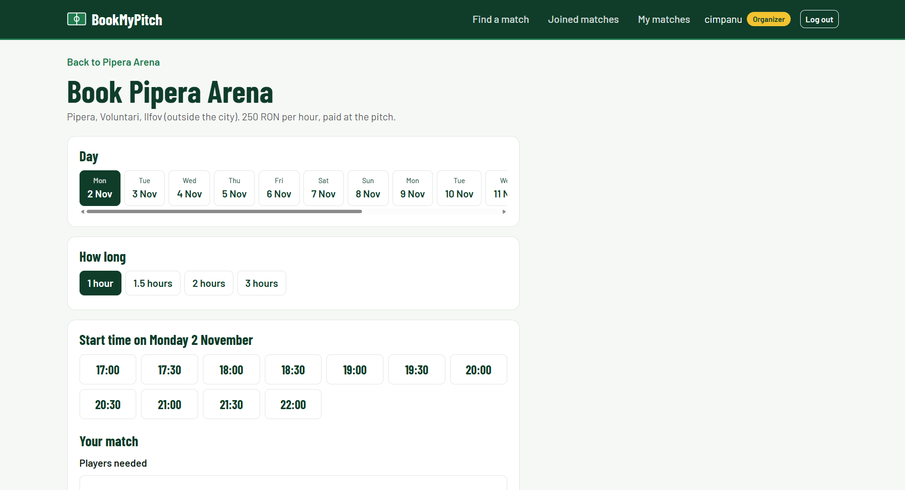
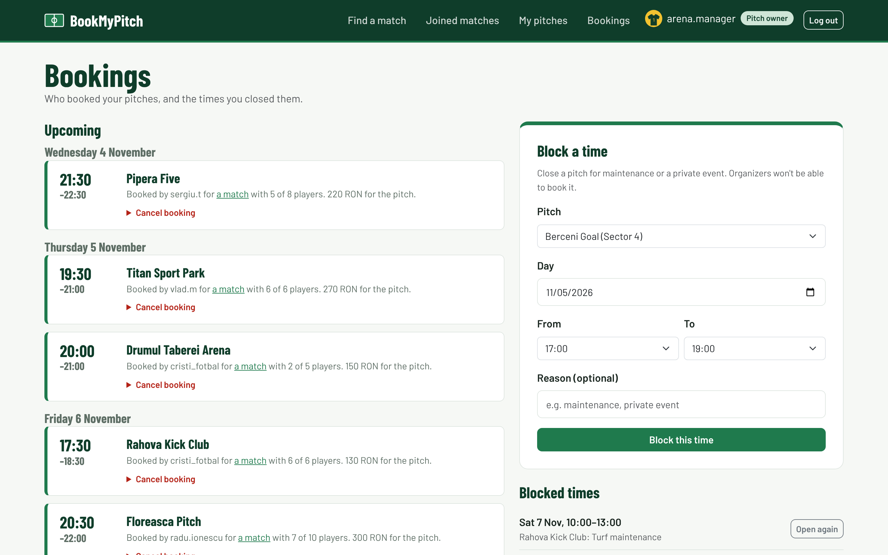

# BookMyPitch

[](https://github.com/eddycimpanu/bookmypitch/actions/workflows/tests.yml)

Find and join pickup football matches on synthetic pitches in Bucharest. Pitch owners list their pitches with opening hours, organizers book a free hour and post a match with open spots, and players take a spot and coordinate in a team chat.


## Features

- **Map of matches and pitches**, with filters by day, sector and open spots.
- **Three roles:**
  - **Players** join and leave matches and talk to their team in a private chat.
  - **Organizers** book a free hour on a listed pitch, which creates the match, or post a match on any pitch they add to the map. They can edit and cancel matches and remove players.
  - **Pitch owners** list pitches with a price per hour and weekly opening hours, see who booked them, cancel bookings with a reason and block hours for maintenance.
- **No double bookings.** PostgreSQL itself refuses two overlapping bookings of the same pitch (an exclusion constraint on time ranges).
- **No overbooked matches.** The last spot can't be taken twice, even when several players click at the same moment (row locking with `select_for_update`).
- **Waitlist.** When a match is full, players can wait in line. When someone leaves, the first in line gets the spot automatically, in the same locked transaction, so nobody can jump the queue.
- **Fair-play rules.** A 1-hour cooldown before rejoining a match you left, no rejoining after being removed, and leaving closes 2 hours before kick-off.
- **91 automated tests**, including concurrency tests, run on every push with GitHub Actions.

## Screenshots

| Match page and team chat | Booking a pitch | Owner's bookings |
| --- | --- | --- |
|  |  |  |

## Tech stack

- **Backend:** Python 3.12, Django 6, PostgreSQL
- **Frontend:** Django templates, Bootstrap 5, JavaScript, Leaflet with OpenStreetMap
- **Testing and CI:** Django's test framework, GitHub Actions

## Run locally

```bash
git clone https://github.com/eddycimpanu/bookmypitch.git
cd bookmypitch
python -m venv venv
venv\Scripts\activate          # macOS / Linux: source venv/bin/activate
pip install -r requirements.txt
```

Create a PostgreSQL database owned by your database user (the migrations enable the `btree_gist` extension, and the tests need the `CREATEDB` permission). Copy `.env.example` to `.env` and fill in your values. Then:

```bash
python manage.py migrate
python manage.py createsuperuser
python manage.py runserver
```

Run the tests with `python manage.py test`.

## Project structure

```
accounts/    custom user model with player, organizer and pitch owner roles, sign up and log in
matches/     pitches, bookings (bookings.py), matches, joining rules and waitlist (services.py), team chat, map API, tests
templates/   Django templates
static/      styles and map / chat scripts
```
