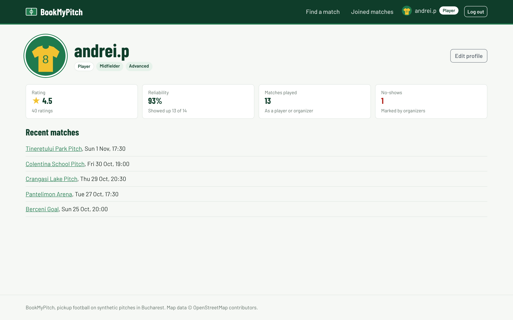

# BookMyPitch

[](https://github.com/eddycimpanu/bookmypitch/actions/workflows/tests.yml)


Pickup football on synthetic pitches in Bucharest. Find a match on the map, take a spot, talk to your team, or book a free hour on a pitch and fill it with players.


## What you can do

| Role | What they can do |
| --- | --- |
| **Player** | Find matches on the map by day, sector and open spots. Take a spot or join the waitlist, chat with the team, rate teammates after the game. |
| **Organizer** | Book a free hour on a listed pitch, which creates the match, or post a match on any pitch. Edit, cancel, remove players and mark no-shows. |
| **Pitch owner** | List pitches with a price and weekly opening hours, see every booking, cancel with a reason and block hours for maintenance. |

## Screenshots

| Match page with lineup and waitlist | Player profile and reputation |
| --- | --- |
|  |  |
| **Booking a pitch** | **Owner's bookings** |
|  |  |

## Under the hood

- **No double bookings.** PostgreSQL itself refuses two overlapping bookings of the same pitch, with an exclusion constraint on time ranges.
- **No overbooked matches.** The last spot can't be taken twice, even when many players click at once, thanks to row locking (`select_for_update`) inside transactions.
- **Fair waitlist.** When someone leaves a full match, the first player in line gets the spot in the same locked transaction, so nobody can jump the queue.
- **Emails that never lie.** Notifications (spot freed, match full, cancelled, kick-off reminder) are sent only after the change is committed.
- **Reputation.** 1 to 5 star ratings between players who actually played, and a reliability score from no-shows marked by the organizer.
- **127 automated tests**, including concurrency tests with real threads, run on every push with GitHub Actions.

## Tech stack

Python 3.12 · Django 6 · PostgreSQL 18 · Django templates · Bootstrap 5 · JavaScript · Leaflet with OpenStreetMap · Docker · GitHub Actions

## Getting started

### With Docker

Install [Docker Desktop](https://www.docker.com/products/docker-desktop/), copy `.env.example` to `.env`, then:

```bash
docker compose up --build
```

The app runs at http://localhost:8000, with PostgreSQL and the kick-off reminders in their own containers. Create an admin with `docker compose exec web python manage.py createsuperuser`.

### Without Docker

```bash
git clone https://github.com/eddycimpanu/bookmypitch.git
cd bookmypitch
python -m venv venv
venv\Scripts\activate          # macOS / Linux: source venv/bin/activate
pip install -r requirements.txt
```

Create a PostgreSQL database owned by your database user (the migrations enable `btree_gist`, and the tests need `CREATEDB`). Copy `.env.example` to `.env`, fill it in, then:

```bash
python manage.py migrate
python manage.py runserver
```

Emails are printed in the terminal. Run `python manage.py send_match_reminders --every 300` for the reminders, and `python manage.py test` for the tests.

## Project structure

```
accounts/    users with player, organizer and pitch owner roles, sign up, log in, profiles
matches/     pitches, matches, bookings, waitlist, team chat, emails, ratings, map API, tests
templates/   Django templates
static/      styles, map and chat scripts
```
